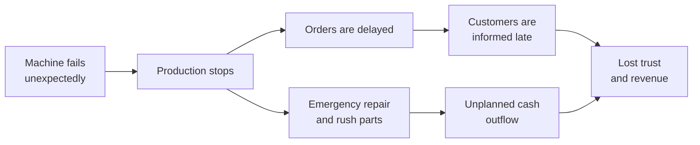
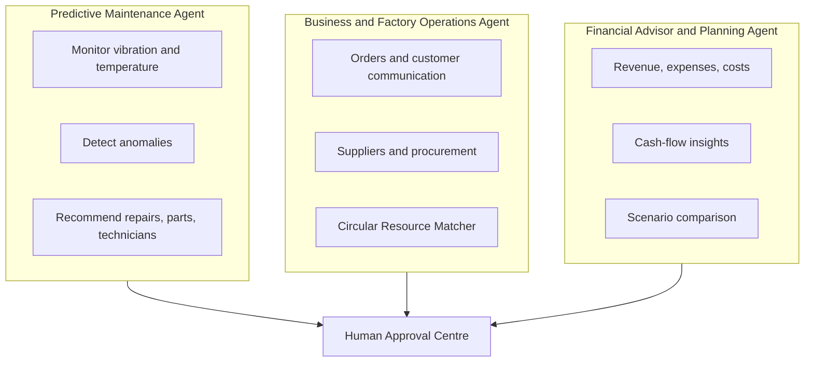
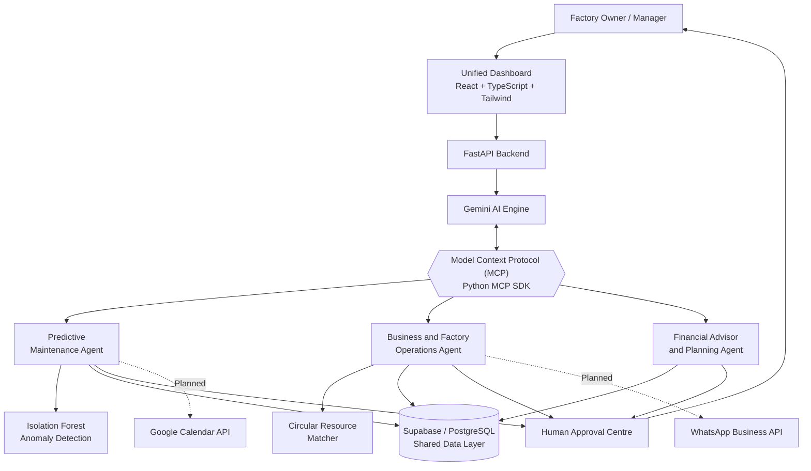
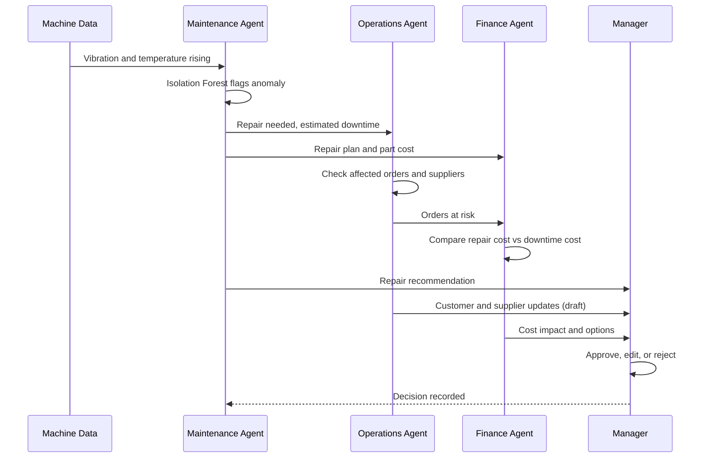
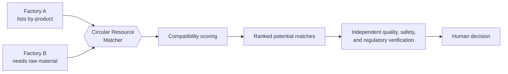

# KAARYA: Connected Manufacturing Intelligence

**Three specialised MCP agents. One connected manufacturing ecosystem.**

*Connecting Machines, Operations, and Finance.*

**Concept demo:** https://tubular-churros-6d0e9b.netlify.app

| | |
|---|---|
| **Team** | CTRL ALT ELITE |
| **College** | Ramaiah Institute of Technology, Bengaluru |
| **Event** | wHACKiest 2026, Online Ideathon (26-27 Nov 2026) |
| **Track** | Track 1: Make MCP Matter, Less Magic, More Utility |

---

## Summary

Small and mid-sized manufacturers run **maintenance, operations, and finance in separate tools**. A problem in one area, such as a failing machine, quietly becomes a problem in another: late orders, extra costs, and cash-flow stress, usually noticed too late.

**KAARYA** connects all three through **MCP-powered AI agents** that share one data layer. A machine warning can become a repair plan, a supplier request, and a budget impact in one flow, and a **human approves every critical action**.

**In one line:** KAARYA turns separate factory tools into one connected team of AI agents that recommend, while people decide.

---

## Table of Contents

1. [Problem Statement](#problem-statement)
2. [Proposed Solution](#proposed-solution)
3. [Before and After KAARYA](#before-and-after-kaarya)
4. [Tech Stack](#tech-stack)
5. [Process Flow and Architecture](#process-flow-and-architecture)
6. [Novelty and Innovation](#novelty-and-innovation)
7. [Impact and Feasibility](#impact-and-feasibility)
8. [Business Model](#business-model)
9. [Current Status](#current-status)
10. [Future Scope](#future-scope)
11. [Team](#team)

---

## Problem Statement

Manufacturing businesses often manage machine maintenance, customer communication, procurement, resource allocation, and financial planning through **disconnected systems**. Each system holds only part of the picture, so nobody sees how one event affects the rest of the business.

| Area | Typical Pain Point | Business Consequence |
|---|---|---|
| Machine maintenance | Breakdowns are found after they happen | Unplanned downtime and costly emergency repairs |
| Orders, suppliers, procurement | Manual coordination and follow-ups | Delivery delays and unhappy customers |
| Resource allocation | Idle capacity and unused by-products | Wasted material and higher costs |
| Financial planning | No view of how events affect cash flow | Poor budgeting and late decisions |

### How one problem spreads

Today, each step in this chain is handled by a different person or tool, usually after the damage is done.

---

## Proposed Solution

KAARYA is an AI-powered manufacturing intelligence platform built from **three specialised agents** that communicate through the **Model Context Protocol (MCP)** and share one database. A human-in-the-loop **Approval Centre** keeps people in control.

### Agent responsibility map

### 1. Predictive Maintenance Agent
- Analyses machine parameters such as vibration and temperature
- Detects unusual behaviour using anomaly detection
- Generates maintenance recommendations and repair plans
- Helps identify technicians and spare parts

### 2. Business and Factory Operations Agent
- Coordinates customer communication, orders, suppliers, and procurement
- Supports production and resource management
- Hosts the **Circular Resource Matcher**

### 3. Financial Advisor and Planning Agent
- Analyses revenue, expenses, and production costs
- Provides cash-flow insights and budgeting assistance
- Supports financial planning and scenario comparison, for example repair now versus replace the machine

### Why MCP

MCP is a standard way for AI to use tools and data. In KAARYA, it lets every agent call the same tools and read the same data, so the AI works with real information instead of only generating text.

| Without MCP | With MCP in KAARYA |
|---|---|
| Custom, hard-coded integration for every tool | Standard, reusable tools any agent can call |
| AI that only talks | AI that retrieves data and takes bounded actions |
| Agents that cannot share context | Agents that share one tool and data interface |
| Blind automation | Human approval before critical actions |

---

## Before and After KAARYA

| | Without KAARYA | With KAARYA |
|---|---|---|
| Machine problems | Found after breakdown | Flagged early by anomaly detection |
| Response | Each team reacts separately | One connected recommendation across teams |
| Cost visibility | Known after the invoice arrives | Repair cost versus downtime cost shown upfront |
| By-products | Disposed of as waste | Matched with factories that can use them |
| Decisions | Based on partial information | Based on shared data, approved by a human |

---

## Tech Stack

| Component | Technology | Role |
|---|---|---|
| Frontend | React, TypeScript, Tailwind CSS | Dashboard and Approval Centre |
| Backend | Python, FastAPI | API layer connecting UI, AI, and agents |
| AI Engine | Gemini | Reasoning, summaries, recommendations |
| Agent Architecture | Model Context Protocol (MCP) | Standard tool access for all agents |
| MCP Implementation | Python MCP SDK | Builds the agent tool servers |
| Database | Supabase, PostgreSQL | Shared data layer |
| Anomaly Detection | Scikit-learn, Isolation Forest | Flags abnormal machine behaviour |
| Planned Integrations | WhatsApp Business Cloud API, Google Calendar API | Customer messages and maintenance scheduling |

---

## Process Flow and Architecture

### System architecture

### Example workflow: a machine starts to fail

*This is an illustrative scenario of the intended behaviour.*

### Human-in-the-loop principle

| Agent does | Human does |
|---|---|
| Detects, analyses, drafts, recommends | Reviews and decides |
| Prepares customer and supplier messages | Approves before anything is sent |
| Compares financial options | Chooses the course of action |

---

## Novelty and Innovation

### 1. Three connected agents instead of three separate tools

Most tools solve one problem: maintenance software, ERP, or accounting. KAARYA links all three, so one event flows through maintenance, operations, and finance in a single workflow.

| Typical approach | KAARYA |
|---|---|
| Separate tool for each function | One connected agent ecosystem |
| Data stays in silos | Shared data layer across agents |
| Teams relay information manually | Agents pass context automatically |
| Automation without oversight | Human approval at critical steps |

### 2. Circular Resource Matcher

The matcher identifies opportunities where industrial by-products from one manufacturer could serve as raw materials for another, supporting a circular economy.

| Factor | What is checked |
|---|---|
| Material type | Is it the kind of material the buyer needs? |
| Composition | Does it fit the requirements? |
| Quantity | Is there enough supply for the demand? |
| Location | Is transport practical? |
| Compatibility | Overall suitability |

> **Responsible use:** matches are potential opportunities only and require independent quality, safety, and regulatory verification before any exchange.

### 3. MCP used for utility, not hype

Each MCP tool maps to a concrete factory task, such as checking machine health, drafting a supplier update, or comparing repair costs. Critical actions wait for human approval. This follows the track theme: less magic, more utility.

---

## Impact and Feasibility

### Impact

| Area | Expected benefit |
|---|---|
| Maintenance | Fewer unexpected breakdowns through early warning |
| Operations | Faster coordination between teams and suppliers |
| Resources | Less waste and better use of by-products |
| Finance | Clearer visibility for planning decisions |
| Sustainability | Industrial resource sharing supports a circular economy |

### Feasibility

| Factor | Why it is achievable |
|---|---|
| Mature technology | React, FastAPI, PostgreSQL, and Scikit-learn are widely used and well documented |
| MCP support | An official Python SDK exists, so agents can be built as modular tool servers |
| Lightweight ML | Isolation Forest is simple and works without labelled failure data |
| Safe adoption | Human approval allows gradual, low-risk rollout |
| Modular integrations | WhatsApp and Google Calendar can be added one at a time |

---

## Business Model

*Proposed model, to be validated.*

| Element | Description |
|---|---|
| Target customers | Small and mid-sized manufacturers and MSMEs |
| Revenue | Subscription per factory, tiered by number of machines and agents used |
| Add-ons | Paid integrations and premium analytics |
| Resource marketplace | Optional listing or transaction fee on Circular Resource Matcher connections |
| Go-to-market | Pilot with local industrial clusters, then expand through partners |

---

## Current Status

KAARYA is at the **ideathon stage**. A UI concept demo shows the idea using simulated data.

| Item | Status |
|---|---|
| Problem definition and solution design |  Done |
| Architecture and agent design |  Done |
| UI concept demo (dashboard and modules) |  Available, uses simulated data |
| Machine readings, listings, financial figures |  Simulated and illustrative |
| Assistant and Approval Centre interactions |  Simulated |
| Working MCP servers and agent coordination |  Planned |
| Anomaly detection model |  Planned |
| WhatsApp Business and Google Calendar |  Planned |
| Real-time IoT sensor input |  Future scope |

**Legend:**  Done ·  Concept demo ·  Planned

---

## Future Scope

- Real-time industrial IoT sensor integration
- Advanced predictive maintenance
- Functional MCP tool execution and agent coordination
- WhatsApp Business and Google Calendar integrations
- Expanded industrial resource marketplace
- Advanced financial analytics

---

## Team

**Team CTRL ALT ELITE**, Ramaiah Institute of Technology, Bengaluru

| Name | Role |
|---|---|
| Samyak Shankar | Team Lead |
| Sannidhi R Devadiga | Member |
| Uttham G | Member |
| Rishikesh P | Member |

wHACKiest 2026 · Track 1: Make MCP Matter, Less Magic, More Utility

---

**KAARYA: Connecting Machines, Operations, and Finance.**
