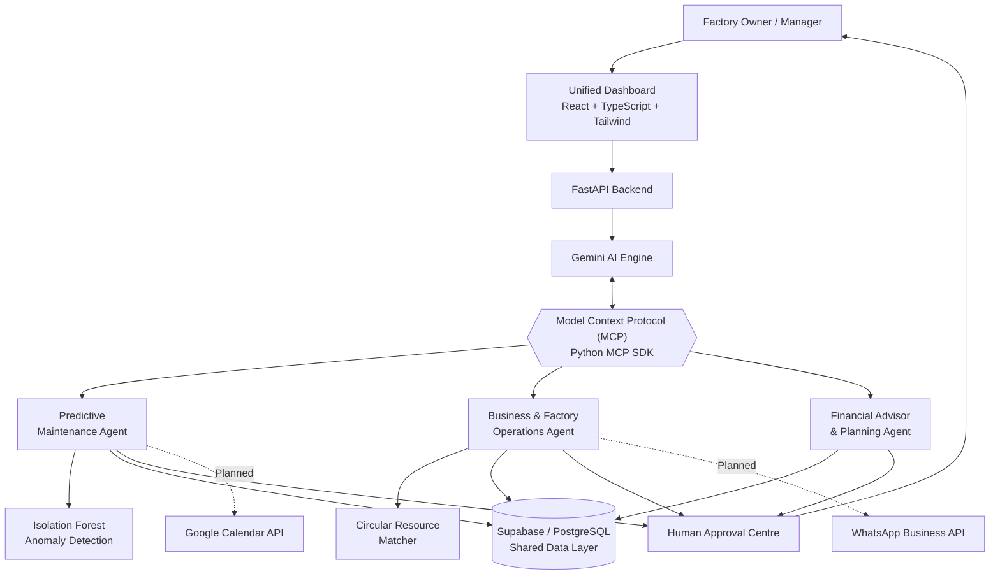

<div align="center">

#  KAARYA

### Connected Manufacturing Intelligence

**Three specialised MCP agents. One connected manufacturing ecosystem.**

*Connecting Machines, Operations, and Finance.*


###  [**Live Demo →**](https://tubular-churros-6d0e9b.netlify.app)

**Built by Team CTRL ALT ELITE · Ramaiah Institute of Technology**

</div>

---

##  TL;DR

> Small and mid-sized manufacturers run **maintenance, operations, and finance in separate tools**. Problems in one area (a failing machine) silently become problems in another (late orders, cash-flow stress), and nobody sees it in time.
>
> **KAARYA** connects all three through **MCP-powered AI agents** that share one data layer, so a machine warning can become a repair plan, a supplier request, and a budget impact, **with a human approving every critical action.**

---

##  Table of Contents

1. [The Problem](#-the-problem)
2. [Our Solution](#-our-solution)
3. [How It Works (Architecture)](#-how-it-works)
4. [The Three Agents](#-the-three-agents)
5. [Key Innovation: Circular Resource Matcher](#-key-innovation-circular-resource-matcher)
6. [Why MCP? (Less Magic, More Utility)](#-why-mcp-less-magic-more-utility)
7. [Example Workflow](#-example-end-to-end-workflow)
8. [Features](#-features)
9. [Tech Stack](#-tech-stack)
10. [Prototype Status (Honest Scope)](#-prototype-status-honest-scope)
11. [Getting Started](#-getting-started)
12. [Future Scope](#-future-scope)
13. [Team](#-team)

---

##  The Problem

Manufacturing businesses typically manage these areas in **disconnected systems**:

| Area | Typical Pain Point |
|---|---|
|  Machine maintenance | Breakdowns are discovered *after* they happen |
|  Orders, suppliers, procurement | Manual coordination, delays, missed follow-ups |
|  Resource allocation | Idle capacity and wasted by-products |
|  Financial planning | Limited visibility into how operational events affect cash flow |

**The result:** unexpected downtime, coordination delays, inefficient resource use, and poor financial visibility.

---

##  Our Solution

**KAARYA** (*कार्य*, "work / task") is an AI-powered manufacturing intelligence platform built from **three specialised agents** that communicate through the **Model Context Protocol (MCP)**.

| # | Agent | Purpose |
|---|---|---|
| 1| **Predictive Maintenance Agent** | Detect machine problems early and plan repairs |
| 2 | **Business & Factory Operations Agent** | Coordinate orders, suppliers, procurement, and resources |
| 3 | **Financial Advisor & Planning Agent** | Turn operational events into financial insight |

Plus a **human-in-the-loop Approval Centre**, so AI recommends and people decide.

---

##  How It Works



**One shared data layer + one protocol = agents that work together instead of living in separate silos.**

---

##  The Three Agents

### 1 Predictive Maintenance Agent
- Analyses machine parameters such as **vibration** and **temperature**
- Detects abnormal behaviour using **Isolation Forest** anomaly detection
- Generates **maintenance recommendations and repair plans**
- Helps identify **technicians and spare parts**

### 2 Business & Factory Operations Agent
- Coordinates **customer communication, orders, suppliers, and procurement**
- Supports **production and resource management**
- Hosts the **Circular Resource Matcher** (see below)

### 3 Financial Advisor & Planning Agent
- Analyses **revenue, expenses, and production costs**
- Provides **cash-flow insights** and **budgeting assistance**
- Supports **business scenario comparison** (e.g., "repair now vs. replace machine")

---

##  Key Innovation: Circular Resource Matcher

**Idea:** one factory's waste can be another factory's raw material.

The matcher finds potential connections between **industrial by-product suppliers** and **businesses that need raw materials**, scoring each match on:

| Factor | What is checked |
|---|---|
|  Material type | Is it the kind of material the buyer needs? |
|  Composition | Does the make-up fit requirements? |
|  Quantity | Is there enough supply for the demand? |
|  Location | Is transport practical? |
|  Compatibility | Overall suitability score |

**Impact:** less industrial waste, lower raw-material costs, and a step toward a circular economy.

>  **Responsible use:** All matches are *potential opportunities only* and require **independent quality, safety, and regulatory verification** before any real exchange.

---

##  Why MCP? (Less Magic, More Utility)

KAARYA is designed around the track theme: **MCP should be useful, not a buzzword.**

| Without MCP | With MCP in KAARYA |
|---|---|
| Hard-coded integrations per tool | Standardised, reusable **tools** the AI can call |
| AI that only "talks" | AI that **retrieves real data and takes bounded actions** |
| Agents that can't share context | Agents that share one **common tool & data interface** |
| Blind automation | **Human approval** before critical actions |

**Design principles**
1. **Utility first:** every agent solves a concrete factory problem.
2. **Transparent:** recommendations show the data behind them.
3. **Human-in-the-loop:** sensitive actions wait for approval.
4. **Modular:** new agents or integrations plug in through MCP.

---

##  Example End-to-End Workflow

```text
1.  Sensor data shows vibration + temperature rising on Machine #3
2.  Isolation Forest flags it as an anomaly
3.  Maintenance Agent recommends a bearing replacement + finds a spare part & technician
4.  Operations Agent checks affected orders and drafts a customer/supplier update
5.  Finance Agent estimates repair cost vs. cost of downtime
6.  Everything lands in the Approval Centre → the manager approves or edits
7.  Reports update across the dashboard
```

---

##  Features

-  **Unified manufacturing dashboard**
-  **Factory overview & machine monitoring**
-  **Predictive maintenance interface**
-  **Order & operations management**
-  **Circular Resource Matcher**
-  **Financial insights & planning**
-  **Human-in-the-loop Approval Centre**
-  **Reports**
-  **KAARYA Assistant** (conversational interface)

---

## 🛠️ Tech Stack

| Layer | Technology |
|---|---|
| **Frontend** | React, TypeScript, Tailwind CSS |
| **Backend** | Python, FastAPI |
| **AI Engine** | Gemini |
| **Agent Architecture** | Model Context Protocol (MCP) |
| **MCP Implementation** | Python MCP SDK |
| **Database** | Supabase, PostgreSQL |
| **Anomaly Detection** | Scikit-learn (Isolation Forest) |
| **Planned Integrations** | WhatsApp Business Cloud API, Google Calendar API |

---

##  Prototype Status (Honest Scope)

We believe in being transparent about what is built today versus what is planned.

| Capability | Status |
|---|---|
| Dashboard & all UI modules |  Built |
| Machine readings |  Simulated data |
| Circular Resource Matcher listings |  Sample data |
| Financial figures |  Illustrative data |
| KAARYA Assistant & Approval flows |  Simulated interactions |
| Live MCP tool execution & agent coordination |  Planned |
| WhatsApp Business & Google Calendar |  Planned |
| Real-time IoT sensor input |  Planned |

**Legend:**  Built ·  Simulated for demonstration ·  Planned

---


##  Future Scope

-  Real-time **industrial IoT sensor** integration
-  Advanced predictive maintenance models
-  Fully functional **MCP tool execution** and agent-to-agent coordination
-  **WhatsApp Business** and  **Google Calendar** integrations
-  Expanded **industrial resource marketplace**
-  Advanced financial analytics

---

##  Team

**Team CTRL ALT ELITE**
 Ramaiah Institute of Technology, Bengaluru
 wHACKiest 2026 · Track 1: *Make MCP Matter, Less Magic, More Utility*

<!-- Add team members: Name · Role · GitHub/LinkedIn -->

---

<div align="center">

**KAARYA: Connecting Machines, Operations, and Finance.**

</div>
